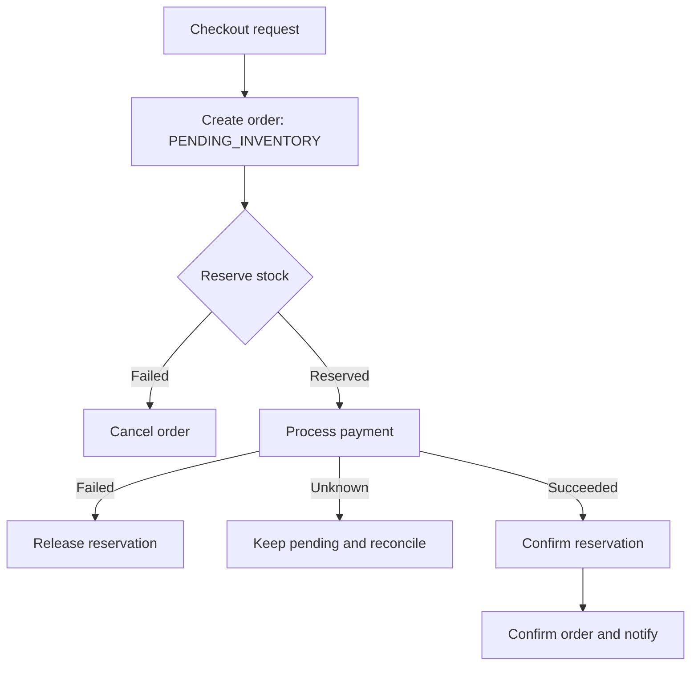
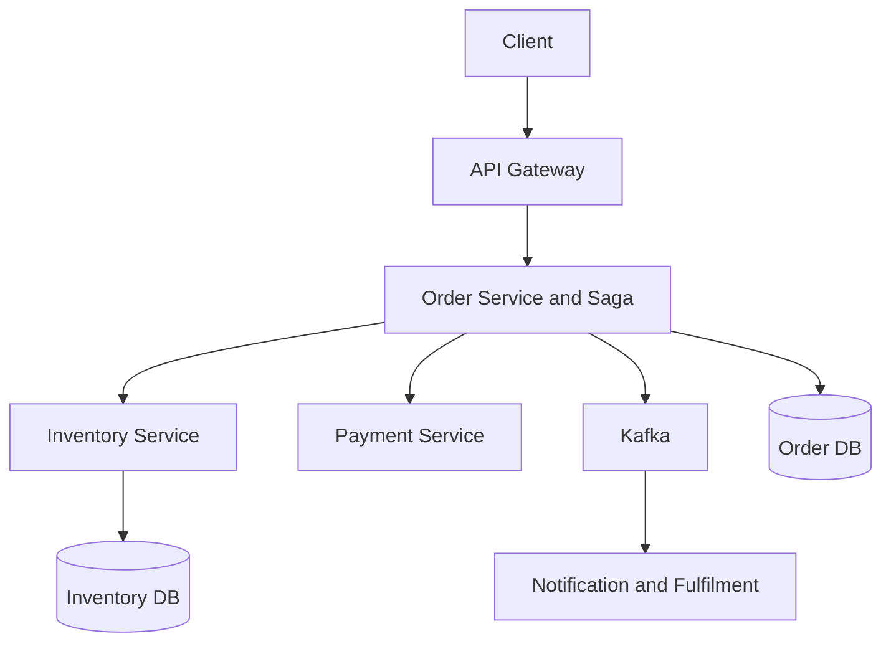

# Mock 08 — E-commerce Order and Inventory (Attempt 01)

**Date:** 2026-10-15  
**Type:** HLD  
**Evaluator:** ChatGPT  
**Status:** Incomplete — stopped before the data model, architecture and deep dives  
**Partial score:** 28/50  
**Suggested re-attempt:** 2026-10-25

## Problem

Design an e-commerce order and inventory system where customers browse products, add items to a cart, place orders and pay. Inventory must be reserved safely so limited stock is not sold to multiple customers. The initial scope uses one warehouse per order, while the design should allow multiple warehouses later.

## Partial scorecard

| Area | Score | Evidence | Main gap |
|---|---:|---|---|
| Requirements | 7/10 | Customer flow, one-warehouse scope, reservation timeout, cancellation and failure cases were identified | Actors and the three state machines needed clearer separation |
| Architecture | 3/10 | Main service APIs were named | Data model and component architecture were not attempted |
| Problem-solving | 5/10 | Basic refund and reservation-release behaviour was identified | Overselling, concurrency and Saga recovery were not attempted |
| Scale and trade-offs | 6/10 | DAU, order/search traffic, SLOs and consistency were estimated | Flash-sale hot-SKU behaviour and inventory write amplification were incomplete |
| Communication | 7/10 | Answers were clear and easy to follow | The mock format went too deep into follow-ups and exceeded the intended time |
| **Total** | **28/50** | **Useful partial attempt** | **Not a complete interview assessment because the mock stopped early** |

## Candidate answer preserved

### Functional requirements

- Register users.
- Search products.
- Add products to a cart.
- Place an order and make payment.
- View order history.
- Receive notifications about order status.
- One order uses products from one warehouse in the initial scope.
- Backorders and pre-orders are out of scope.

### Initial failure decisions

- Reserve inventory when checkout/payment begins.
- Reservation TTL is configurable, approximately 5–10 minutes.
- If payment succeeds but reservation fails, initiate a refund.
- If inventory is reserved but payment fails, release it.
- Cancellation/refund rules depend on the fulfilment stage and business policy.

### Scale assumptions

- 10 million daily active users.
- 5 million orders/day.
- One item/order for the first estimate.
- About 57 average order requests/second.
- About 171 order requests/second at a 3× peak.
- 50 million product searches/day, about 579 average search RPS.
- 99.99% availability.
- Search latency below 200 ms.
- At-least-once event delivery with idempotent consumers.

### APIs proposed

```text
POST   /api/v1/cart
GET    /api/v1/cart
POST   /api/v1/orders
GET    /api/v1/orders/{orderId}
POST   /api/v1/orders/{orderId}/cancel
GET    /api/v1/orders/history
POST   /api/v1/inventory/reservations
POST   /api/v1/inventory/reservations/{id}/confirm
POST   /api/v1/inventory/reservations/{id}/release
POST   /api/v1/payments
```

The checkout idempotency key is sent in the request header. The server recalculates price from trusted catalogue/pricing data instead of trusting a client-provided final amount.

## Corrections to the state models

### Order state

```text
CREATED
  -> PENDING_INVENTORY
  -> PENDING_PAYMENT
  -> CONFIRMED
  -> PACKED
  -> SHIPPED
  -> DELIVERED
```

Failure paths:

```text
CREATED/PENDING_* -> CANCELLED
CONFIRMED         -> CANCELLING -> CANCELLED
CONFIRMED         -> REFUND_PENDING -> REFUNDED
```

The exact cancellation transitions depend on whether packing or shipping has started.

### Payment state

```text
INITIATED -> PROCESSING -> SUCCEEDED
                        -> FAILED
SUCCEEDED -> REFUND_PENDING -> REFUNDED / REFUND_FAILED
```

Use `REFUNDED`, not a general `REFUND` state.

### Inventory reservation state

```text
RESERVED -> CONFIRMED
         -> RELEASED
         -> EXPIRED
```

`OUT_FOR_DELIVERY` and `DELIVERED` belong to order fulfilment, not inventory reservation.

## Missing Detail — Inventory Reservation Design

### Goal

Reservation temporarily holds stock for one checkout. It must prevent overselling, expire automatically and make confirm/release operations idempotent.

### Data model

#### inventory

```text
warehouse_id
sku_id
on_hand_quantity
reserved_quantity
version
updated_at

PRIMARY KEY (warehouse_id, sku_id)
CHECK on_hand_quantity >= 0
CHECK reserved_quantity >= 0
CHECK reserved_quantity <= on_hand_quantity
```

Available stock is calculated as:

```text
available_quantity = on_hand_quantity - reserved_quantity
```

#### inventory_reservation

```text
reservation_id
order_id
warehouse_id
sku_id
quantity
status              // RESERVED, CONFIRMED, RELEASED, EXPIRED
expires_at
created_at
updated_at
version

UNIQUE (order_id, warehouse_id, sku_id)
```

The unique constraint makes a repeated reservation request for the same order and item idempotent.

### Atomic reserve operation

For each item, perform a conditional update:

```sql
UPDATE inventory
SET reserved_quantity = reserved_quantity + :quantity,
    version = version + 1,
    updated_at = now()
WHERE warehouse_id = :warehouseId
  AND sku_id = :skuId
  AND on_hand_quantity - reserved_quantity >= :quantity;
```

- One updated row means the reservation succeeded.
- Zero updated rows means there is insufficient stock or the SKU does not exist.
- Insert the `RESERVED` reservation row in the same database transaction.
- A database condition, not an application-level read followed by write, prevents overselling.

An alternative is `SELECT ... FOR UPDATE`, but the conditional update usually holds the lock for less time and works well for a hot SKU.

### Reserve several items

Because the current scope uses one warehouse, reserve all order items in one local database transaction:

1. Sort items by SKU ID to keep lock order consistent and reduce deadlocks.
2. Apply the conditional update for every SKU.
3. Insert each reservation row.
4. If any item cannot be reserved, roll back the entire transaction.

This gives all-or-nothing reservation for the order.

For future multi-warehouse support, each warehouse may own its stock and the Order Saga must compensate by releasing reservations already created at other warehouses.

### Confirm reservation

After payment succeeds:

```sql
UPDATE inventory
SET on_hand_quantity = on_hand_quantity - :quantity,
    reserved_quantity = reserved_quantity - :quantity,
    version = version + 1
WHERE warehouse_id = :warehouseId
  AND sku_id = :skuId
  AND reserved_quantity >= :quantity;
```

In the same transaction, move the reservation from `RESERVED` to `CONFIRMED` using an expected-state condition:

```text
WHERE reservation_id = ? AND status = 'RESERVED'
```

If confirm is delivered twice, the second request sees `CONFIRMED` and returns the existing result without deducting stock again.

### Release reservation

When payment fails, checkout is cancelled or the reservation expires:

```sql
UPDATE inventory
SET reserved_quantity = reserved_quantity - :quantity,
    version = version + 1
WHERE warehouse_id = :warehouseId
  AND sku_id = :skuId
  AND reserved_quantity >= :quantity;
```

Move the reservation from `RESERVED` to `RELEASED` in the same transaction. Repeated release requests are harmless because only a `RESERVED` row can be released.

### Expiration worker

A background worker finds expired reservations in small batches:

```sql
SELECT reservation_id
FROM inventory_reservation
WHERE status = 'RESERVED'
  AND expires_at <= now()
ORDER BY expires_at
FOR UPDATE SKIP LOCKED
LIMIT 500;
```

For every claimed row, it releases `reserved_quantity` and marks the reservation `EXPIRED` in one transaction.

Multiple expiry workers can run safely because `SKIP LOCKED` gives each worker a different batch.

### Reservation API

```http
POST /api/v1/inventory/reservations
Idempotency-Key: order-123-reserve
```

```json
{
  "order_id": "order-123",
  "warehouse_id": "warehouse-10",
  "items": [
    {"sku_id": "sku-1", "quantity": 2},
    {"sku_id": "sku-2", "quantity": 1}
  ],
  "ttl_seconds": 600
}
```

Success:

```json
{
  "reservation_id": "res-456",
  "status": "RESERVED",
  "expires_at": "2026-10-15T04:10:00Z"
}
```

Insufficient stock should return a business conflict such as `409 Conflict`, including which SKU could not be reserved.

### Payment timeout versus reservation expiry

A payment timeout does not always mean payment failure. Money may have been captured even though our response timed out.

Therefore:

1. Keep the order in `PENDING_PAYMENT` or `PAYMENT_UNKNOWN`.
2. Do not immediately release the reservation while the payment result is ambiguous.
3. Extend the reservation for a controlled grace period if necessary.
4. Resolve payment using webhook/status reconciliation.
5. Confirm inventory on payment success.
6. Release inventory only after confirmed failure or final timeout policy.

If the reservation must expire before payment can be resolved and payment later succeeds, initiate a refund or attempt a new reservation according to a clearly defined business policy. Do not silently create an order without stock.

## Correct Checkout Flow



Recommended sequence:

1. Create the order using a durable idempotency record.
2. Reserve inventory before charging the customer.
3. Start payment.
4. On payment success, confirm the reservation and order.
5. On confirmed payment failure, release the reservation and cancel the order.
6. On ambiguous payment outcome, keep the workflow pending and reconcile it.

This sequence makes “payment succeeded but inventory reservation failed” uncommon because stock is reserved first.

## Architecture That Was Not Reached



### Component responsibilities

- **Catalogue Service:** product descriptions and searchable attributes.
- **Pricing Service:** authoritative price, promotion and tax calculation.
- **Cart Service:** short-lived customer selections; Redis or a database with TTL.
- **Order Service:** owns the order state machine and coordinates the Saga.
- **Inventory Service:** sole owner of inventory and reservation transitions.
- **Payment Service:** payment initiation, webhook processing, refund and reconciliation.
- **Kafka:** durable asynchronous events between services.
- **Notification Service:** informs the customer without blocking checkout.
- **Fulfilment Service:** packing, shipment and delivery tracking.

Every service updates its local database and writes an outbox event in one transaction. Consumers use inbox/deduplication records and expected-state transitions.

## Two Critical Deep Dives for the Re-attempt

### 1. Preventing overselling in a flash sale

- Inventory Service is the only writer for a warehouse/SKU.
- Use an atomic conditional database update.
- Partition inventory by warehouse and SKU hash when one database is insufficient.
- A single extremely hot SKU still has a serialization limit; sharding cannot split one stock counter without making correctness harder.
- Apply waiting rooms, per-user limits, rate limiting and admission control before the inventory database.
- Cache may display approximate availability, but reservation always checks the authoritative database.

### 2. Saga compensation

| Failure | Compensation |
|---|---|
| Reservation fails | Cancel order; do not start payment |
| Payment definitely fails | Release reservation and cancel order |
| Payment result is unknown | Keep pending; reconcile before releasing |
| Payment succeeds but order confirmation fails | Retry idempotent order confirmation from durable Saga state/outbox |
| Payment succeeds but stock was lost unexpectedly | Refund payment and cancel; alert operations |
| Customer cancels before fulfilment | Release/return inventory as appropriate and initiate refund |

## Missing Interview Questions

1. How do you avoid overselling when two requests reserve the last unit?
2. Why is a cache lock not sufficient for inventory correctness?
3. What happens when payment succeeds but the Order Service crashes?
4. How do you prevent duplicate reservation, payment and refund effects?
5. How does a reservation-expiry worker avoid releasing confirmed stock?
6. How do you handle payment still being unknown when reservation TTL expires?
7. How do you split an order across warehouses later?
8. How do flash-sale waiting rooms and admission control protect inventory?
9. How do you reconcile physical warehouse stock with logical stock?
10. What metrics reveal stuck reservations or inventory leakage?

## Monitoring

- Reservation success and conflict rate.
- Reservation latency.
- Oldest active/expired reservation.
- Reserved quantity versus active reservation totals.
- Negative-inventory invariant violations.
- Orders stuck in `PENDING_INVENTORY` or `PENDING_PAYMENT`.
- Payment success without confirmed order.
- Released, expired and confirmed reservation counts.
- Hot SKU traffic and database lock time.
- Saga compensation and reconciliation backlog.

## One-Hour Re-attempt Plan

| Time | Section |
|---:|---|
| 0–5 min | Requirements and scope |
| 5–10 min | Scale, SLO and consistency |
| 10–15 min | APIs and state machines |
| 15–23 min | Data model |
| 23–33 min | Architecture and normal checkout flow |
| 33–43 min | Overselling and atomic reservation deep dive |
| 43–52 min | Saga, payment ambiguity and compensation |
| 52–57 min | Failures, security and monitoring |
| 57–60 min | Final summary |

## Re-attempt goal

Complete the full design within 60 minutes. If a section reaches its time limit, state the key decision and move on. Do not exhaustively answer every possible follow-up during the main design.
